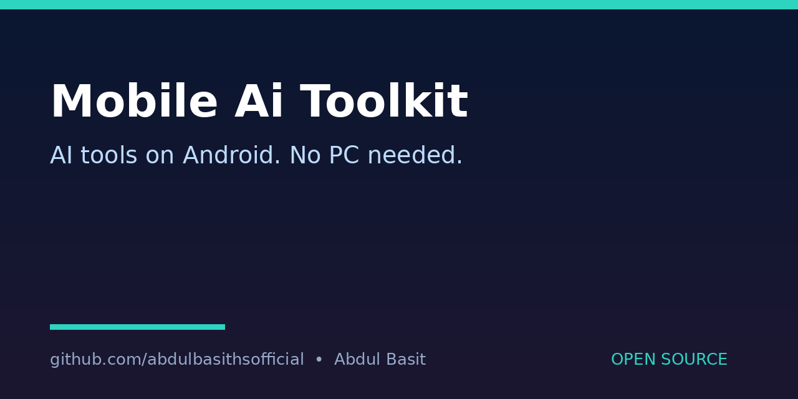

# MobileAI-Toolkit
Benefit: Helps Android users run AI command-line tools on their phone without a PC, with Termux-based setup checklists — in the spirit of Mobile-Antigravity, but for general AI CLI tools.

## What it does
Lists the setup steps for running AI CLI tools on Android via Termux, and prints the exact Termux commands for a chosen tool category. It does not install anything itself and does not claim any specific tool will work on every phone.

## Quick start
```bash
python3 toolkit.py --list
python3 toolkit.py --setup coding
```

## How to run
- `python3 toolkit.py --list` shows the available categories.
- `python3 toolkit.py --setup <category>` prints Termux setup steps for that category.
- Categories: `coding`, `chat`, `image`. You still need your own accounts/keys for any tool that requires them; no keys are included here.
